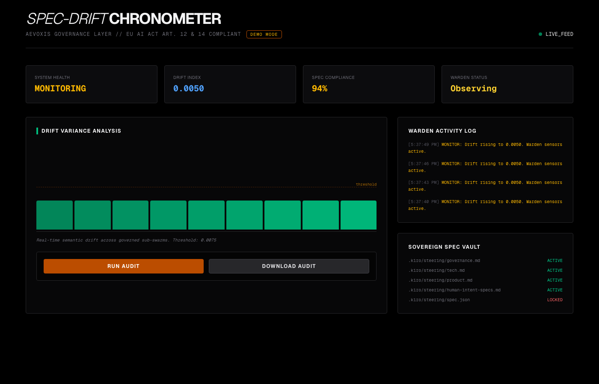
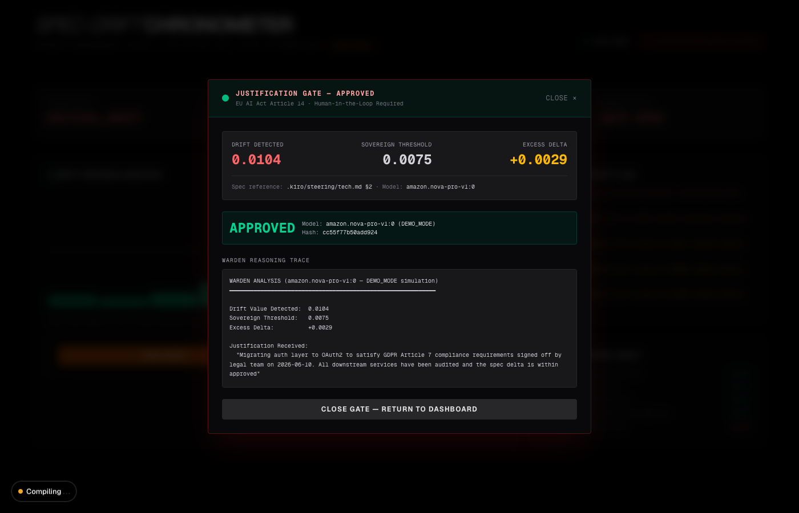

# Spec-Drift Chronometer

[](https://github.com/VinitaSilaparasetty/spec-drift_chronometer/actions/workflows/ci.yml)
[](LICENSE)
[](https://www.python.org/)
[](#eu-ai-act-mapping)

**An open, vendor-neutral oversight gate for AI agents.** The Chronometer measures how far an AI agent's output drifts from a written, human-defined intent. When the drift crosses a threshold, it stops execution until a person gives a justification, checks that justification instead of rubber-stamping it, and records every decision in a tamper-evident log.

*Created by [Vinita Silaparasetty](https://github.com/VinitaSilaparasetty). Open source under Apache-2.0, free for anyone to use, study, adapt and run on their own infrastructure.*

---

## Why this matters

AI agents increasingly take part in decisions about people: job applications, benefit claims, advice, public-service chatbots. The EU AI Act asks for effective human oversight (Art. 14) and traceable records (Art. 12). In practice, oversight fails in three ways:

1. **Approvals become rubber stamps.** Someone who sees many requests clicks "yes" without thinking. An approval without a reason protects nobody.
2. **The rules themselves are unprotected.** The intent files that an agent is checked against can be edited. In my tests, adding ten lines to an intent file permanently switched off detection for a whole topic area, without anyone noticing (see [Research](#research)). Whoever can change the intent can switch off the oversight.
3. **Oversight tools are mostly proprietary platforms.** Public authorities, municipalities, non-profits and small organisations need a free building block they can run themselves, inspect, and adapt to their own rules.

The Chronometer is built to protect the people that AI systems make decisions about, and to give smaller organisations oversight they control.

## What makes it different

Drift detection and human-approval steps already exist separately. The Chronometer combines them and adds what the others leave out:

| | Drift monitors | Approval gates | **Spec-Drift Chronometer** |
|---|---|---|---|
| Measures drift from human intent | Yes | No | **Yes** |
| Stops execution when drift is too high | No (report only) | Fixed tool lists | **Yes, triggered by measured drift** |
| Checks the quality of the human's justification | No | No | **Yes, weak justifications are rejected** |
| Protects the intent files against tampering | No | No | **Planned: signed intent store** |
| Tamper-evident decision log | Varies | Varies | **Yes (Art. 12)** |

## Status

**Today (working prototype).** Drift measurement, the justification gate, LLM-scored justifications via `WARDEN_LLM` (with Mistral, a vague justification such as "I updated the code" scores 30/100 and is rejected; specific, traceable ones score 85/100) and a downloadable audit trail, with a demo dashboard and a LangChain/LangGraph integration.

### Known limitations

The research in [`test_research/`](test_research/) tested this prototype against itself. These findings are open and drive the roadmap:

- **Keyword bypass.** With `mistral-small-2506`, the single word "approved" scored 85/100 and passed the gate. LLM scoring alone is not a sufficient check.
- **Unprotected intent files.** Ten added lines in an intent file silenced detection for a whole topic area (see [Research](#research)).
- **No identity check on approvals.** The gate evaluates the text of a justification, not who submitted it.
- **Silent evaluator failure.** If the scoring model is unreachable, the gate records a normal-looking rejection instead of an error.
- **Near misses are not logged.** Changes just below the threshold leave no record.
- **Demo mode uses a simulated evaluator.** In `DEMO_MODE` no model is called; any justification longer than 20 characters is approved, so the demo runs without API keys.

**Next (roadmap).** Turning the prototype into a lightweight Python library that runs without any cloud account:

- [ ] **Signed intent store:** every intent file signed and versioned (Ed25519); changes need a valid signature and pass through the gate themselves
- [ ] **Downgrade detector:** flags edits that lower detection for whole topic areas, the failure pattern found in the research
- [ ] **Local, open models** for scoring justifications (for example Mistral or Llama via Ollama), swappable
- [ ] **Hash-chained, signed decision log** for Art. 12 record-keeping
- [ ] **Adapters** for LangChain/LangGraph callbacks, OpenTelemetry spans (GenAI conventions) and an MCP middleware
- [ ] **Open benchmark:** the failure-mode test suite published so other oversight tools can be measured against it
- [ ] **Release on PyPI**, with the dashboard kept optional

Feedback and contributions on any of these are welcome: please open an issue.

## Who it is for

Developers who deploy AI agents in public administration, municipalities, non-profits, research and small organisations: for example a city's citizen chatbot, an application assistant or a consumer-advice bot. Indirectly, the people those systems decide about.

---

## Demo

**Live demo: [spec-drift-chronometer.aevoxis.de](https://spec-drift-chronometer.aevoxis.de)** (runs in `DEMO_MODE`; the first load can take up to a minute while the free-tier server wakes up).



> Normal operating state: drift 0.0050 against a 0.0075 threshold, gate observing.



> Art. 14 gate end to end: drift reached 0.0104 against the 0.0075 threshold, a human submitted a justification, and the evaluator returned APPROVED with a hash-stamped reasoning trace. Captured in DEMO_MODE.

## Quickstart

Requirements: Python 3.12+, Node.js 18+, npm 9+

```bash
git clone https://github.com/VinitaSilaparasetty/spec-drift_chronometer.git
cd spec-drift_chronometer
chmod +x dev.sh
DEMO_MODE=true ./dev.sh
```

Open http://localhost:3000. No cloud credentials needed.

Demo flow (about 45 seconds):

1. Drift rises through MONITORING into CRITICAL_DRIFT
2. The justification gate appears
3. Submit a justification: the evaluator returns APPROVED or REJECTED with its reasoning
4. Click **Run Audit**, then **Download Audit** to export the audit trail

## Connecting to your AI system

The Chronometer wraps around an AI system you already run. It does not replace the pipeline; it governs it. The example below uses a LangChain RAG chatbot; the same pattern applies to any LangChain-compatible chain, LangGraph graph or agent.

```bash
cd integrations/langchain_rag
cp .env.example .env   # add your model API key
pip install -r requirements.txt
python check.py        # verify setup before running
python rag_chatbot.py
```

```python
from warden_client import WardenClient
from warden_callback import WardenCallbackHandler

warden = WardenClient(base_url="https://your-warden-api.example.com")
handler = WardenCallbackHandler(warden, dashboard_url="https://your-dashboard.example.com")

# One line adds the oversight gate to your existing chain
rag_chain = (your_existing_chain).with_config(callbacks=[handler])
```

When the gate triggers, the chain is blocked and the operator is directed to submit a justification. The gate clears only on approval.

Full integration code, a LangGraph example and setup checks are in [`integrations/langchain_rag/`](integrations/langchain_rag/).

## How the prototype works

- **Intent files** (`.kiro/steering/`): human-written intent that every decision is checked against (`human-intent-specs.md`, `governance.md`, `tech.md`, and machine-readable thresholds in `spec.json`).
- **Drift engine** (FastAPI backend): measures semantic drift between the intent files and AI output and exposes it to the dashboard.
- **Justification gate**: blocks execution above the threshold until a person justifies the action; an LLM evaluator scores the justification against the intent.
- **Audit trail**: every governance decision is logged with a verification hash and can be downloaded.

### Choosing the justification evaluator

Set `WARDEN_LLM` to choose the model that scores justifications:

| `WARDEN_LLM` | Model |
|---|---|
| `mistral` | mistral-small-2506 |
| `gemini` | gemini-1.5-flash |
| `huggingface` | meta-llama/Llama-3.1-8B-Instruct |
| unset | built-in mock in demo mode; Amazon Bedrock (Nova Pro) in production mode |

Removing the dependency on hosted models, by supporting local open models, is on the [roadmap](#status). See `.env.example` for all configuration options.

## EU AI Act mapping

| Article | How the Chronometer supports it |
|---|---|
| Art. 14, human oversight | Execution is blocked until a person approves, and the approval must carry a justification that is checked |
| Art. 12, record-keeping | Every governance decision is logged with a verification hash |
| Art. 13, transparency | The drift value is visible to operators in real time |
| Art. 50, disclosure | The system identifies itself as AI-governed at its interaction points |

The Chronometer is a technical building block. Using it does not by itself make a system compliant with the AI Act.

## Research

The [`test_research/`](test_research/) folder contains the empirical test suite behind a paper on EU AI Act compliance failure modes:

- `run_tests.py`: drift measurement across real git commits, justification-gate evaluation across nine quality levels, and audit-trail generation
- `run_failure_modes.py`: twelve structured failure-mode and gap tests covering Articles 9, 12, 13, 14, 17 and 50

**Headline finding:** a 10-line addition to the intent files reduced drift detection for an entire vocabulary domain from 0.0113 to 0.0044, crossing the gate threshold in reverse and silencing detection permanently. This is the gap the planned signed intent store and downgrade detector are designed to close.

All results were generated with `WARDEN_LLM=mistral` (model `mistral-small-2506`, temperature 0). See [`test_research/README.md`](test_research/README.md) for the full reproduction procedure.

## Contributing

Issues, ideas and pull requests are welcome, especially:

- integrations with other agent frameworks
- new failure-mode tests for the benchmark
- real-world intent-file examples from public-sector or non-profit use cases

## License

Licensed under the [Apache License 2.0](LICENSE). Earlier versions of this repository were published under AGPL-3.0; from this version on, the project is Apache-2.0 only.
